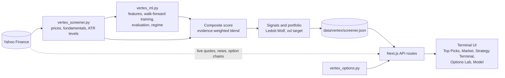

# VertexCapital

[](https://github.com/utkarrsh07/VertexCapital/actions/workflows/ci.yml)   

A quantitative equity research terminal. VertexCapital ranks 567 S&P 500 and TSX 60 stocks every day by combining a machine-learning model of price and volume behaviour with sector-relative fundamentals, tests the model walk-forward over roughly ten years of data it never trained on, and presents the results in a live web terminal with trade levels, a market heatmap, news, and defined-risk option ideas.

> Research and education project. Not investment advice; no orders are ever placed.

## What it does

- **Ranks the whole universe daily** on a 0-100 score and assigns relative signals (Strong buy, Buy, Hold, Reduce, Sell).
- **Machine-learning model** (ridge regression + histogram gradient boosting) trained on 16 price/volume features from the academic literature, validated with a purged, expanding-window walk-forward test.
- **Fundamental model**: nine factors (valuation, growth, profitability, balance sheet, risk, momentum) ranked within each GICS sector.
- **Evidence-weighted blend**: the machine-learning share of each score is set every scan by its own out-of-sample t-statistic (25% with no edge, up to 65%).
- **Trade levels** from volatility (ATR): entry zone, stop and target for every stock.
- **Portfolio construction**: top-ranked names sized by score and volatility, sector caps, Ledoit-Wolf covariance, a volatility target and a market-regime filter.
- **Web terminal** (Next.js): Top Picks with plain-language reasons and live news, a sector heatmap with market breadth, a strategy terminal, an Options Lab, and a Model page that compares the strategy with the S&P 500, Nasdaq, Dow, Russell 2000, TSX and MSCI World.

## Architecture



## How the model works

**Universe and data.** 567 stocks (S&P 500 and TSX 60), 13 years of daily adjusted prices and current fundamentals from Yahoo Finance, refreshed by each scan.

**Features.** Every month, each feature is ranked across all stocks (rank-normalised to [-0.5, 0.5]) so the model learns relative, not absolute, patterns and is robust to outliers.

| Feature | Research basis |
|---|---|
| 12-1 month momentum | Jegadeesh & Titman (1993) |
| 6-1 month momentum | Jegadeesh & Titman (1993) |
| 3 month momentum | Jegadeesh & Titman (1993) |
| 1 month reversal | Jegadeesh (1990) |
| 3M volatility | Ang, Hodrick, Xing & Zhang (2006) |
| 3M downside volatility | Ang, Chen & Xing (2006) |
| 1Y beta | Frazzini & Pedersen (2014) |
| Idiosyncratic volatility | Ang, Hodrick, Xing & Zhang (2006) |
| Distance to 52W high | George & Hwang (2004) |
| Price vs 50-day avg | Brock, Lakonishok & LeBaron (1992) |
| Price vs 200-day avg | Brock, Lakonishok & LeBaron (1992) |
| Max daily return (lottery) | Bali, Cakici & Whitelaw (2011) |
| Amihud illiquidity | Amihud (2002) |
| Volume shock 20d/120d | Gervais, Kaniel & Mingelgrin (2001) |
| RSI(14) | Wilder (1978) |
| Sector-relative momentum | Moskowitz & Grinblatt (1999) |

**Target.** Each stock's next-21-trading-day return minus the universe median, rank-normalised. Predicting relative performance removes the market's direction, which no stock-level model can forecast reliably.

**Models.** Ridge regression (linear, interpretable) and histogram gradient boosting (non-linear interactions), combined by averaging their cross-sectional ranks.

**Validation.** Expanding-window walk-forward: the first 24 months train the model, which then predicts the next month, retraining every 3 months. A one-month purge gap stops training labels overlapping the test month (Lopez de Prado, 2018). Turnover is charged 10 basis points each way, and holdings use a buffer rule (keep names while they stay in the top 40%) to avoid trading on small rank changes.

**Calibration.** The out-of-sample average excess return and hit rate of each model quintile become each stock's "expected 1-month excess" and "beat the universe" figures, so expectations come from measured history rather than assumptions.

## Results
Walk-forward, out-of-sample: **2016-11-28 to 2026-10-08** (119 monthly rebalances, ~9.9 years). The model never saw a month before predicting it. Generated from the scan of 2026-11-06.

| Metric | Value |
|---|---|
| Rank information coefficient (ensemble) | +0.016 (t-stat 1.18, positive in 50% of months) |
| Strategy vs equal-weight universe | +5.8% per year |
| Average monthly turnover | 27% |

| Line | CAGR | Volatility | Sharpe | Max drawdown |
|---|---|---|---|---|
| VertexCapital strategy (top quintile, net of costs) | +23.2% | 22.1% | 1.05 | -31.6% |
| Nasdaq 100 (QQQ) | +19.6% | 21.3% | 0.92 | -33.0% |
| Equal-weight universe | +17.3% | 17.3% | 1.00 | -27.2% |
| S&P 500 (SPY) | +14.7% | 16.8% | 0.87 | -24.1% |
| Dow Jones (DIA) | +12.6% | 16.2% | 0.78 | -26.1% |
| TSX 60 (XIU) | +12.5% | 13.5% | 0.92 | -23.3% |
| MSCI World (ACWI) | +12.2% | 16.3% | 0.75 | -25.9% |
| Russell 2000 (IWM) | +9.0% | 21.8% | 0.41 | -36.7% |

**How to read this.** The fair comparison is the strategy against the equal-weight universe, because both share the same stock list (and the same survivorship bias, below). A rank IC around 0.03-0.05 with a t-stat above 2 is generally considered a useful signal; the current t-stat of 1.18 does not yet meet that bar, which is why the score gives the machine-learning model a weight set by its own evidence.

## Limitations

- **Survivorship bias.** The universe is today's index members, so companies that were removed or went bankrupt are missing. This flatters every backtest on this page, often by 1-3% a year over a decade.
- **Not point-in-time data.** Yahoo adjusted prices can be revised; a professional system would use a point-in-time database.
- **Fundamentals are not backtested.** Free data only provides current values, so the nine fundamental factors cannot be validated historically.
- **Options ideas are not backtested.** Free data has no option price history.
- Past out-of-sample performance does not guarantee future results.

## Tech stack

Python (pandas, NumPy, scikit-learn, yfinance) for data, modelling and backtesting; Next.js 15 / React 19 / TypeScript for the terminal; hand-built SVG charts; GitHub Actions for tests.

## Running locally

```powershell
python -m venv .venv
.venv\Scripts\Activate.ps1
pip install scikit-learn yfinance pandas numpy scipy pytest
python -u backend/vertex_screener.py --root .     # full scan: ~25 minutes, 13 years of prices
cd terminal; npm install; npm run dev              # open http://localhost:3000/vertex
```

Tests: `python -m pytest tests/test_vertex_screener.py tests/test_vertex_options.py` (offline, synthetic data, including a check that the walk-forward model finds a planted signal and finds nothing in pure noise).

## Key files

| Path | Purpose |
|---|---|
| `backend/vertex_screener.py` | Scan pipeline: data, fundamentals, trade levels, scoring, signals, portfolio, report |
| `backend/vertex_ml.py` | Features, walk-forward training, evaluation, calibration, regime, benchmarks |
| `backend/vertex_options.py` | Option chains and Black-Scholes helpers for the Options Lab |
| `terminal/app/vertex/page.tsx` | Terminal UI |
| `terminal/app/api/vertex/` | API routes: report, candles, live quotes, market snapshot, news, options, scan |
| `tests/` | Offline tests for the pipeline, the model and the options code |

## References

Jegadeesh & Titman (1993); Jegadeesh (1990); Moskowitz & Grinblatt (1999); Blitz, Huij & Martens (2011); George & Hwang (2004); Ang, Hodrick, Xing & Zhang (2006); Frazzini & Pedersen (2014); Bali, Cakici & Whitelaw (2011); Amihud (2002); Novy-Marx (2013); Asness, Frazzini & Pedersen (2019); Gu, Kelly & Xiu (2020), "Empirical Asset Pricing via Machine Learning"; Ledoit & Wolf (2004); Lopez de Prado (2018), *Advances in Financial Machine Learning*.
